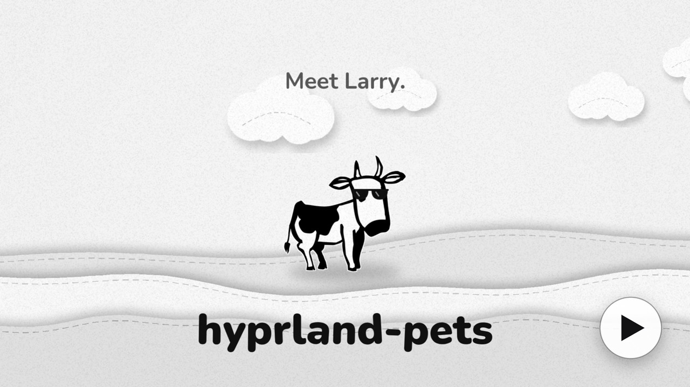
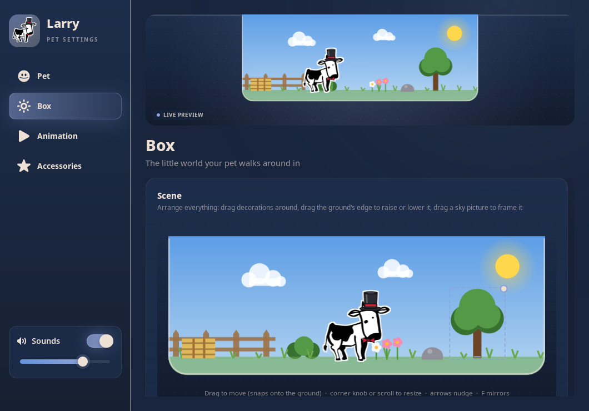
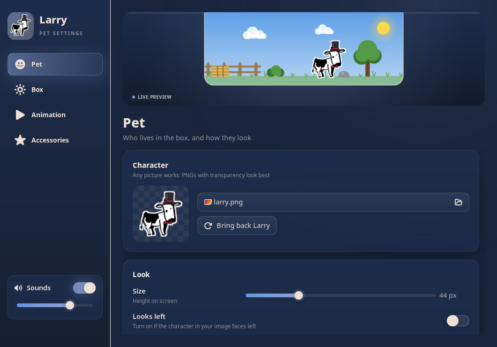
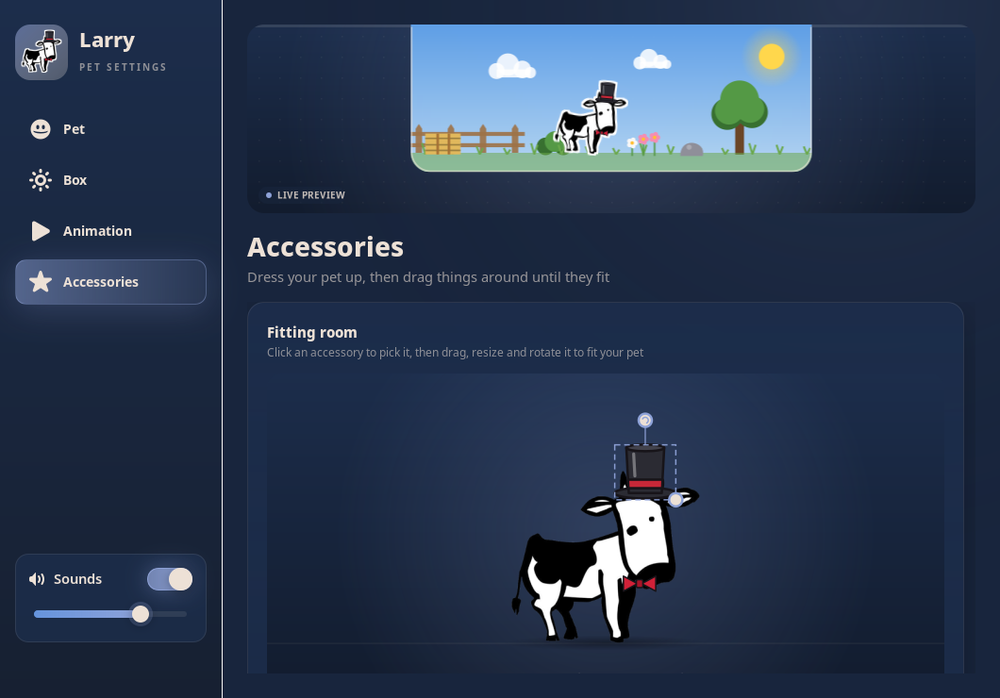
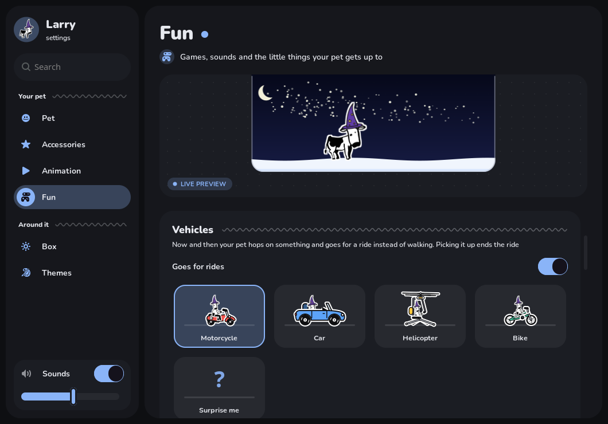
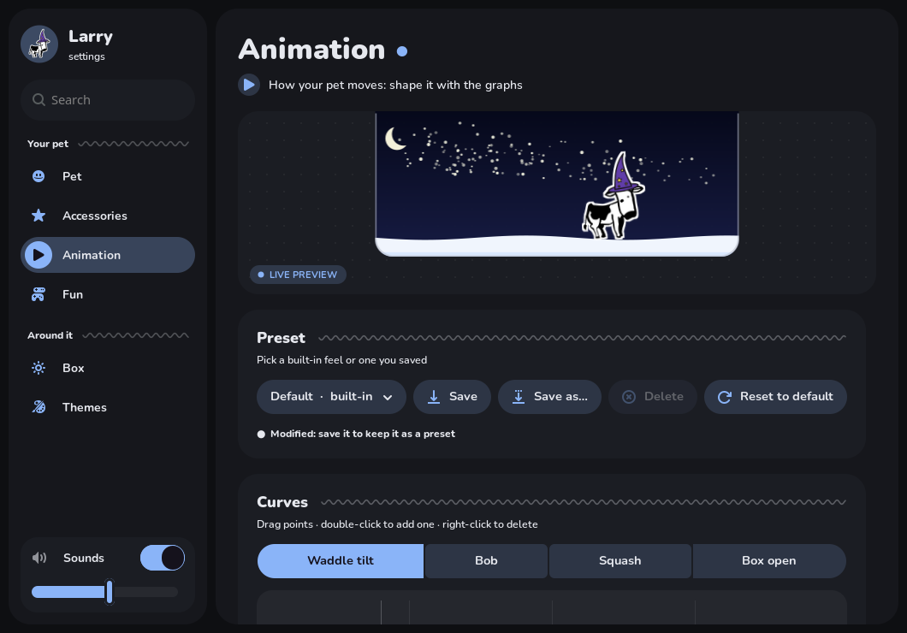
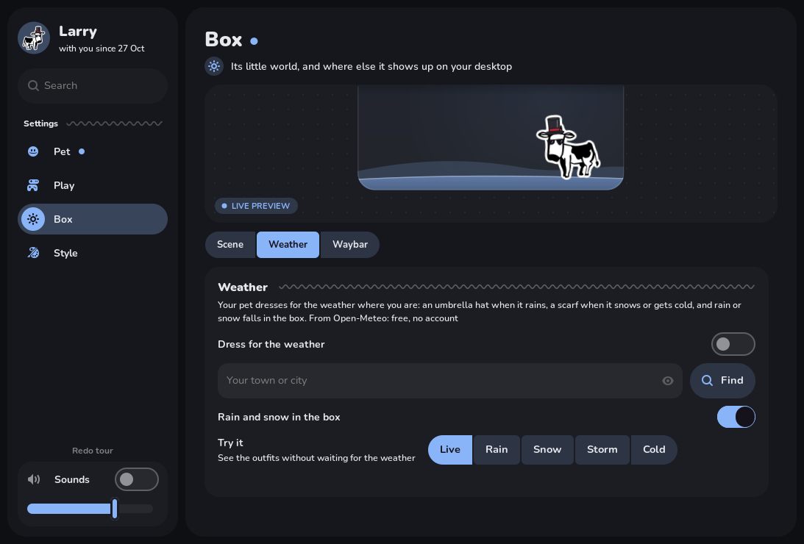
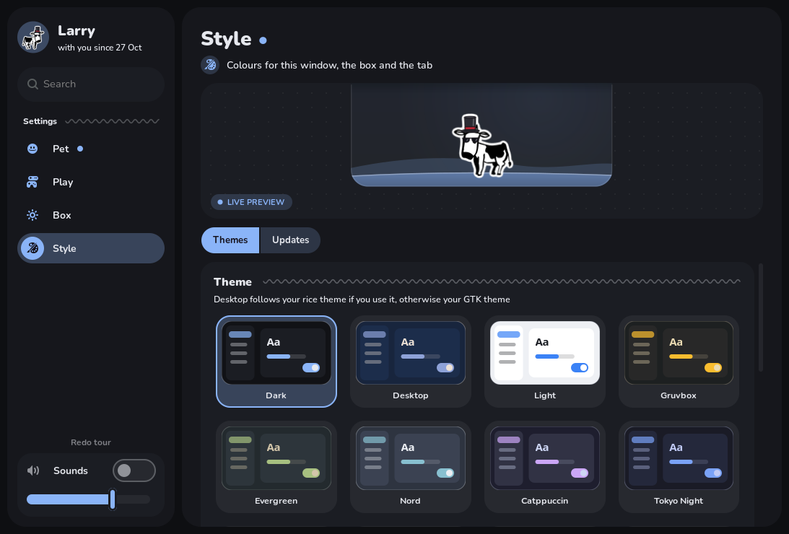

# hyprland-pets

A little pet that lives in a pull-down box on the edge of your Hyprland screen.

**Website: [bugzysleeps.github.io/hyprland-pets](https://bugzysleeps.github.io/hyprland-pets/)** (go drag Larry around)

Hover the tab and the box slides out with your pet wandering around inside. Drag the pet out and
it drops onto your desktop, lands on top of your windows (and rides along when you move them),
and walks around on top of everything. Drag it back into the box to put it away. It hides itself
while anything is fullscreen.

The default pet is **Larry the Cow**, but any picture works, and almost everything else is
customisable from a settings window: the box's scene, the pet's accessories, and how it moves.

[](docs/showcase.mp4)

*Click to watch the 50-second trailer (with sound).*



## Features

- **Tells you about updates.** About twice a day it asks GitHub for the latest release. When there's a
  new one, your pet says so once, and settings shows a banner: What's new, or Update (which runs the
  installer in a terminal; nothing ever updates by itself). Turn it off under Settings → Style → Updates.
- **A proper welcome.** The first time you open settings, two panels slide apart as your pet spins
  out between them; you name it, then a four-step tour shows the box, picking it up, petting and
  where everything is (skip it if you like, or take it again from Pet → Look, or "Redo tour" in the sidebar).
- **Name it.** Set your pet's name in settings (the sidebar also says how long it's been with you).
- **Any picture as your pet.** PNGs with transparency look best; solid backgrounds can be cut out
  automatically. Size and facing direction are adjustable, and the sticker outline around it can be
  any colour (from a colour wheel) and 1-8 px thick, or turned off. Vehicles get the same outline.
- **Recolour Larry.** Pick his skin, spot and outline colours on a colour wheel (any colour at all),
  type a hex code, or start from a preset like Jersey, Highland, Chocolate or Strawberry. Every pose
  follows: walking, sitting, sleeping, thrown, held, typing and riding.
- **A calm little box.** A soft card in your theme with a gentle sky (theme, day, sunset or night)
  and a smooth floor (grass, soil, sand, snow or stone), tinted to your theme or in natural colours.
  Use your own pictures as the floor (it repeats across) or the sky (zoom and pan it in settings).
- **Accessories.** 16 built-in ones (top hat, party hat, crown, cowboy hat, beanie, wizard hat,
  chef hat, grad cap, viking helmet, halo, devil horns, sunglasses, nerd glasses, bow tie, bow,
  flower) plus your own pictures. Fit them in the fitting room: drag, resize and rotate until
  they sit right on your pet. They lean, bob and flip with it.
- **My pets and pet packs.** Keep several pets and switch between them on the My pets page; each
  remembers its picture, name, size, accessories and animation, and saves itself as you change it.
  Export one as a single `.larrypet` file to share, and import other people's (pick the file, or drop
  it on the settings window). Imports are checked: only the expected files are read, sizes are
  capped and every picture is re-encoded.
- **Dances to music.** When anything's playing (Spotify, mpv, a browser tab: whatever shows up in
  `playerctl`), your pet dances: bops, sways, spins, kicks, headbangs and bounces, a new move every
  couple of bars, with music notes floating up. With cava installed it listens and dances in time
  with the song; without it, a steady 120 BPM.
- **Seasonal accessories.** Around holidays, limited ones show up to claim: a pumpkin and witch hat
  for Halloween, a Santa hat and antlers for Christmas, star glasses for New Year, heart boppers
  for Valentine's, a lucky hat for St. Patrick's and bunny ears in spring. Your pet tells you when
  there's something new. Claim it while the season's on and it stays in your wardrobe for good.
- **Animation you shape with graphs.** Walk speed, step length, tilt, bob, squash, wandering,
  gravity, throwing and bounciness, plus curves you drag to shape each step and the box opening.
  Five presets built in; save your own and switch between them.
- **It can move into your terminals.** Drag the pet onto a terminal window and let go: it drops
  to the bottom and walks along inside, moves and resizes with the window, hides behind windows
  stacked over it, and disappears with it when you switch workspace. Drop it above a window
  instead and it stands on top, same as always. Grab it to take it back out.
- **Idle behaviours.**
  - Bring the mouse close and it stops and turns to look at it; Larry's eyes follow the cursor.
  - Larry sits down now and then.
  - With the box shut, it now and then pokes its head out beside the tab, has a look round and
    ducks back in.
  - Leave the mouse alone for a while and it falls asleep, with little z's floating up. Bring the
    mouse close to wake it.
  - Each one can be turned off under Play → Fun.
- **Box optional.** Don't want the pull-down box? Turn off "Show the box and tab" (Settings → Box → Scene)
  and your pet just lives on your desktop; with the Waybar module, its click tucks the pet away and
  brings it back.
- **Waybar module.** Turn on "Show in Waybar" (Settings → Box → Waybar) and a little square with your pet's
  face appears at the far left of your bar, showing how it feels: happy eyes and a heart when
  petted, closed eyes and a "z" asleep, wide eyes when thrown, a note when dancing; a tooltip says
  what it's up to. Click it and your pet pops out with a puff of smoke and a hop (click again to
  poof it back into its box), right-click for settings. If your Waybar config can't
  be edited safely, the module is written to `~/.config/larry/waybar/` for you to add by hand. If
  something rewrites your Waybar config (a rice theme switch, say), it puts itself back.
- **Dresses for the weather.** Type your town under Settings → Box → Weather and your pet checks the
  weather there every half hour ([Open-Meteo](https://open-meteo.com): free, no account): an
  umbrella hat when it rains, a scarf when it snows or drops to 5°C, and rain or snow falling in
  the box (with lightning in a thunderstorm). "Try it" shows each outfit without waiting.
- **Voice commands** (off by default). Say "Larry, come here" and he walks over to your cursor, or
  say just "Larry", wait for him to perk up with a "?", then the command. Also: dance, sit down, go
  to sleep, wake up, jump, go for a ride, go home, come out, moo, good boy, and there are lots of ways
  to say each ("get over here", "boogie", "good night", "who's a good boy"...). Commands without his
  name are ignored. With `wl-screenrec` installed he can also run a screen recorder: "Larry, start
  recording" / "Larry, stop recording" records the monitor you're on, with desktop audio, into
  ~/Videos/Recordings. He can tell you the time ("Larry, what time is it"), take a screenshot
  ("Larry, screenshot" lets you drag an area, "Larry, screenshot everything" takes the whole monitor;
  saved to ~/Pictures/Screenshots and copied to the clipboard, needs `grim` and `slurp`), and control
  your music with `playerctl` ("Larry, pause the music", "play the music", "next song", "previous
  song"). It's
  recognised offline on your computer by [Vosk](https://alphacephei.com/vosk/) (a one-time ~45 MB
  setup from Settings → Play → Voice, kept in its own folder), only listening for those phrases;
  nothing is ever sent anywhere. Your pet also answers to its own name if it's one ordinary word.
- **Hello and goodbye.** When you log in, your pet climbs out of its box, has a big stretch and says
  good morning (or afternoon, or evening); if you've been away a few days it's extra excited to see you.
  When you shut down or restart, it appears in the middle of the screen, waves goodbye and floats up and
  away before the screen fades out (this one's off by default). It uses systemd-logind's shutdown delay
  (at most 5 seconds), so it works however you shut down. Switch either in Settings → Idle behaviour; `hyprland-pets --goodbye`
  (or "Try it") shows the goodbye without shutting anything down.
- **Game mode** (off by default). Normally your pet hides while something is fullscreen. With game
  mode on, it pops into the bottom-right corner, sits and watches you play instead. It's a still
  picture, so it costs your game nothing, and clicks only land on the pet itself. Click it to send it
  away until you leave fullscreen. Turn it on in Settings → Idle behaviour.
- **Petting.** Hold the middle mouse button (the scroll wheel) on your pet and stroke it: hearts float
  up and it leans into your hand with happy eyes. Keep going and it flops over on its side, blissed
  out (with a little moo if pet sounds are on). It can be turned off under Play → Fun.
- **Reacts to downloads finishing.** When a package manager finishes, the pet hops with hearts and a
  bubble saying what finished, or slumps if it failed. That includes apt/nala, pacman, AUR helpers
  (yay, paru, pikaur…), emerge, dnf, zypper, xbps, apk, flatpak, snap, nix, brew, pip/pipx and
  cargo, on any distro. It also cheers when a browser, wget or aria2 download lands in your
  Downloads folder.
  - Telling success from failure needs a readable log: pacman's and apt's are; on Gentoo, add
    yourself to the `portage` group. Without one, it assumes success.
- **Goes for rides.** Every few minutes the pet hops on a vehicle and drives around for a bit instead of
  walking: a mini motorcycle (the default, with the odd wheelie), a car, a one-person helicopter that
  takes off and flies around with the pet hanging under the rotor, or a bike. Larry sits on them
  properly, front legs on the handlebars, and pedals the bike, still wearing his accessories. Pick one, or "Surprise me", under Play → Fun, and set how often.
  Picking the pet up ends the ride.
- **Catch game.** Throw your pet up and catch it on the way down for +1. Bounce it off a side of the
  screen (or a window) first for +2, or off two sides (a wall, then the top) for +3: every different side adds a
  point. Catches only count in a row: let it land and the streak is over. Your best is kept and shown in the corner of the box,
  with the live streak next to it.
- **Sounds.** Throw Larry and he moos (seven different moos, picked at random).
  Other pets get a muffled, Kenny-style "weee!" (eight of them). There's a blip when you catch it. Off by
  default: turn on **Pet sounds** under Play → Fun.
- **A falling pose.** Throw Larry or pick him up and he stands up and throws his front legs in the air, and while you hold him he waddles all four legs. With the falling pose off he stays on all fours and paddles his legs in the air instead. Other
  pets can get one too: pick any picture as the falling pose in settings.
- **Themes.** Dark (the default), Light, Gruvbox, Evergreen, Nord, Catppuccin, Tokyo Night,
  Dracula, Rosé Pine, Solarized Light and Cherry Blossom, or Desktop to follow your GTK theme.
  Themes colour the settings window, the box and the tab, and switch live.
- **Make your own theme from a palette.** Browse palettes on [Coolors](https://coolors.co/palettes/trending),
  export one (Image, SVG, CSS, ASE or PDF) or copy its link, then upload or paste it under Settings →
  Style → Themes. Name it, pick dark or light, and the theme is made from its colours. Dropping a palette
  file onto the settings window works too.
- **Types in your terminal** (off by default). While it naps in a terminal and you're away, it wakes up
  now and then and types something silly there ("u there?", "brb eating grass"...). Larry sits on his
  butt with a mini keyboard on his lap. The text only appears on screen, the way `write` messages
  do: it's never typed into your shell, and only shows up at a prompt, never over a running program.
- **Tab on any screen edge,** anywhere along it.
- **Physics.** Throw the pet and it flies, bounces off the screen edges and the sides and bottoms of
  windows, and lands on whatever window is under it.
- **Stays out of the way.** Clicks go straight through to your windows everywhere except the
  tab, the box and the pet. Hidden in fullscreen. One small Python process.
- **Searchable settings.** Type in the search box (or press Ctrl+F) to find any setting and jump to it.
- **Satisfying settings window,** with a live preview and soft synthesized click and tick sounds
  (they can be turned off).

| Pet → Look | Pet → Wardrobe |
|---|---|
|  |  |
| **Play → Fun** | **Play → Moves** |
|  |  |
| **Box → Weather** | **Style → Themes** |
|  |  |

## Requirements

- Hyprland
- Python 3.11+ with PyGObject, pycairo and Pillow
- GTK 3 and **gtk-layer-shell with GObject introspection**
- Optional: GStreamer with `pulsesink` for the settings sounds (it works silently without them)
- Optional: `cava`, so the pet dances in time with your music (otherwise it dances at a steady 120 BPM)
- Optional: `wl-screenrec`, for the "start recording" voice command
- Optional: `grim` and `slurp` (and `wl-copy`) for the "screenshot" voice command, `playerctl` for the
  music ones

| Distro | Packages |
|---|---|
| Arch | `python-gobject gtk3 gtk-layer-shell python-cairo python-pillow gst-plugins-good` |
| Gentoo | `dev-python/pygobject x11-libs/gtk+:3 gui-libs/gtk-layer-shell[introspection] dev-python/pycairo dev-python/pillow media-plugins/gst-plugins-pulse` |
| Debian / Ubuntu | `python3-gi python3-gi-cairo gir1.2-gtk-3.0 gir1.2-gtklayershell-0.1 python3-pil gir1.2-gstreamer-1.0 gstreamer1.0-pulseaudio` |
| Fedora | `python3-gobject python3-cairo gtk3 gtk-layer-shell python3-pillow gstreamer1-plugins-good` |

## Install

One line, run in a terminal inside Hyprland:

```sh
curl -fsSL https://github.com/BugzySleeps/hyprland-pets/releases/latest/download/install.sh | bash
```

The installer:

- downloads hyprland-pets to `~/.local/share/hyprland-pets`
- installs any missing packages on Arch, Debian/Ubuntu, Fedora and Gentoo
- puts `hyprland-pets` on your PATH
- adds it to your Hyprland config so it starts with Hyprland
- starts it

It asks before using sudo or changing your config, and backs the config up first. Run the same
line again to update; your settings are never touched.

Options go after `bash -s --`, for example `curl -fsSL … | bash -s -- --yes`:

| | |
|---|---|
| `--yes` | don't ask, answer yes to everything |
| `--no-deps` | only check the packages, don't install them |
| `--no-config` | leave your Hyprland config alone |
| `--uninstall` | remove it again |

**From a clone instead:** `git clone https://github.com/BugzySleeps/hyprland-pets.git && cd hyprland-pets && ./install.sh`
runs it from the clone, so `git pull` updates it.

**Doing it by hand:** install the packages above, link `hyprland-pets` onto your PATH, and add
it to your config:

**hyprland.lua**
```lua
hl.on("hyprland.start", function()
    hl.exec_cmd("hyprland-pets")
end)
hl.window_rule({ name = "float-pet-settings", match = { class = "^larry$" }, float = true, center = true })
```

**hyprland.conf** (the window rule syntax differs between Hyprland versions, so check the wiki
for yours)
```ini
exec-once = hyprland-pets
windowrule = float, class:^(larry)$
```

## Usage

| | |
|---|---|
| Hover the tab | the box slides out |
| Click the tab | keep the box open |
| Right-click the tab, the box or the pet | settings |
| Hold the middle button on the pet and move over it | pet it |
| Settings → **Play** | catch game, sounds, reactions, idle behaviours, falling pose, terminals, animation |
| Drag the pet out of the box | it's free on your desktop |
| Drag it onto a terminal and let go | it moves in and walks along the bottom |
| Drag it back into the open box | put it away |
| `hyprland-pets --settings` | open settings from a keybind or script |

Running `hyprland-pets` again while it's already running does nothing, so it's safe to put in
autostart.

## Files

| Path | What |
|---|---|
| `~/.config/larry/config.toml` | all settings; the settings window writes it, but it's readable and hand-editable |
| `~/.config/larry/animations/` | your saved animation presets |
| `~/.config/larry/{accessories,grounds,skies}/` | copies of pictures you added |
| `~/.config/larry/profile.json` | when you started, and whether you've had the welcome (stays on your computer) |
| `~/.config/larry/claimed.json` | seasonal accessories you've claimed |
| `~/.config/larry/themes/` | themes you made from palettes |
| `~/.config/larry/pets/` | your saved pets, one folder each |
| `~/.local/state/larry/game.json` | your catch-game best |
| `~/.cache/larry/` | rendered sprites and sounds (safe to delete) |

**Theme colours:** pick one under Settings → Style → Themes. With **Desktop**, the box and settings follow
the `rice` theme switcher from [bugzysdotfiles](https://github.com/BugzySleeps/bugzysdotfiles) if you
use it (switching rices recolours them live), otherwise your GTK theme.

## Uninstall

```sh
curl -fsSL https://github.com/BugzySleeps/hyprland-pets/releases/latest/download/install.sh | bash -s -- --uninstall
```

This removes the program and the lines it added to your Hyprland config. Your settings stay in
`~/.config/larry`; delete that folder and `~/.cache/larry` too if you don't want them.

## Project layout

```
hyprland-pets        launcher
install.sh           one-step installer / updater / uninstaller
src/larry.py         the pet: overlay window, physics, Hyprland IPC
src/settings.py      the settings window
src/scene.py         the box: sky and floor
src/accessories.py   built-in + seasonal accessories, placement, claims
src/music.py         is music playing (MPRIS) + beat tracking (cava)
src/packs.py         saved pets + .larrypet import/export
src/fitting_room.py  drag-and-drop accessory editor
src/anim.py          animation parameters, curves and presets
src/curve_editor.py  the graph editor
src/color_wheel.py   the colour wheel for Larry's coat
src/sprites.py       turns a picture into the walking sprite
src/library.py       your own pictures
src/sounds.py        synthesized UI sounds
src/watch.py         notices package managers and downloads finishing
src/termchat.py      the pet's messages in your terminal
src/desktop.py       screenshots and music controls for the voice commands (grim, slurp, playerctl)
src/recorder.py      screen recording for the voice commands (wl-screenrec)
src/voice.py         offline voice commands (Vosk), set up into its own environment
src/weather.py       your local weather (Open-Meteo) and what to wear for it
src/onboarding.py    the first-run welcome: intro animation, naming, the tour
src/updates.py       checks GitHub for a newer release, runs the installer to update
src/version.py       this copy's version (bump it with install.sh's VERSION when releasing)
src/account.py       your local profile (since when, welcomed yet)
src/waybar.py        the Waybar module (and adding it to / removing it from your config)
src/themes.py        colour themes + your own, made from palettes (coolors.co exports, links)
src/fonts/           the settings window's font (Nunito, OFL)
src/vehicles.py      the motorcycle, car, helicopter and bike
src/config.py        settings file
tools/make_falling_larry.py  draws Larry's falling, held (waddling), typing and riding poses,
                             and the coat maps that let him be recoloured
```

## How this was made

I was bored one day and decided to make a desktop pet for hyprland, now I don't know how to code except for some experience in CSS if you count that. I did use claude code opus 5.5 model, this was just a fun project to be honest, enjoy it.

## License

MIT: use it, change it, share it, build on it. Contributions welcome. See [LICENSE](LICENSE).

The settings window uses the [Nunito](https://github.com/googlefonts/nunito) font, bundled in `src/fonts/`
under the SIL Open Font License (`src/fonts/OFL.txt`). It's loaded for the app only, nothing is installed.
